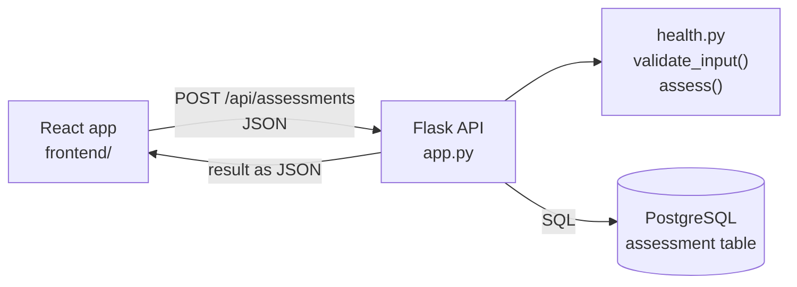

# TerveysCheck

A full stack web app that gives a health assessment from height, weight, waist circumference, age group and activity level: body mass index, waist circumference category, daily energy need and macronutrients.

This is a rebuild of my earlier JavaScript-only version. The front end is now a React app, the calculations run in a Flask REST API, results are stored in PostgreSQL, and the app runs in Docker containers with automated tests and builds in GitHub Actions.

> The results are indicative and not medical advice.


## Tech stack

- **Back end:** Python, Flask, Flask-SQLAlchemy
- **Database:** PostgreSQL (SQLite for local development and tests)
- **Front end:** React, Vite, JavaScript, HTML5, CSS3
- **DevOps:** Docker (multi-stage build), Docker Compose, GitHub Actions (pytest, lint, front end build, Docker build)

# Tech stack

## Architecture



## Run with Docker

```bash
cp .env.example .env          # then set your own password in .env
docker compose up --build
```

Open http://localhost:5000

## Run locally without Docker

Back end (terminal 1):

```bash
python3 -m venv .venv
source .venv/bin/activate
pip install -r requirements.txt
flask --app app run --debug
```

Front end (terminal 2):

```bash
cd frontend
npm install
npm run dev
```

Open http://localhost:5173. Vite forwards `/api` calls to Flask. Without `DATABASE_URL` the back end uses a local SQLite file.

## Project structure

```
app.py          Flask app, database model and API routes
health.py       Calculations and input validation
tests/          pytest tests for the calculations and the API
frontend/src/   React components, API calls and table data
Dockerfile      Builds the React app, then the Python image that serves it
```

## API

| Method | Endpoint | Description |
| --- | --- | --- |
| GET | `/api/health` | Health check |
| POST | `/api/assessments` | Validates the input, calculates the assessment and saves it |
| GET | `/api/assessments` | Lists the 20 latest assessments |

Example request:

```json
POST /api/assessments
{
  "height_cm": 180,
  "weight_kg": 75,
  "waist_cm": 85,
  "gender": "male",
  "age_group": "young",
  "free_activity": "bit-free-active",
  "work_activity": "not-work-active"
}
```

Invalid input returns `400` with an error message per field.

## Tests

```bash
pytest
```

Tests cover the calculations, input validation and the API endpoints. On every push GitHub Actions runs the tests, lints and builds the front end, and builds the Docker image.

## Data protection

- Only anonymous measurements are stored. The name is used in the browser for the greeting and is never sent to the server.
- All input is validated on the server.
- React escapes all text it renders, so user input cannot run as code.
- The database password comes from an environment variable and is not committed to the repository.